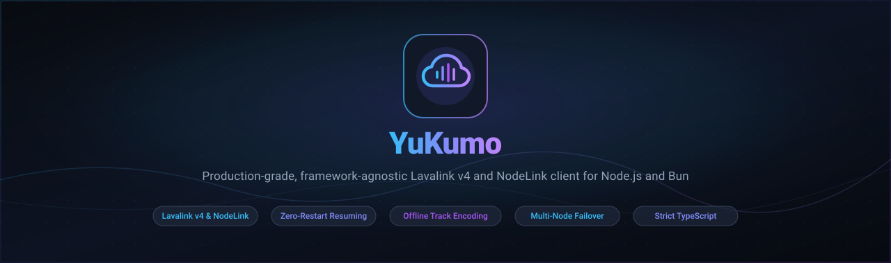
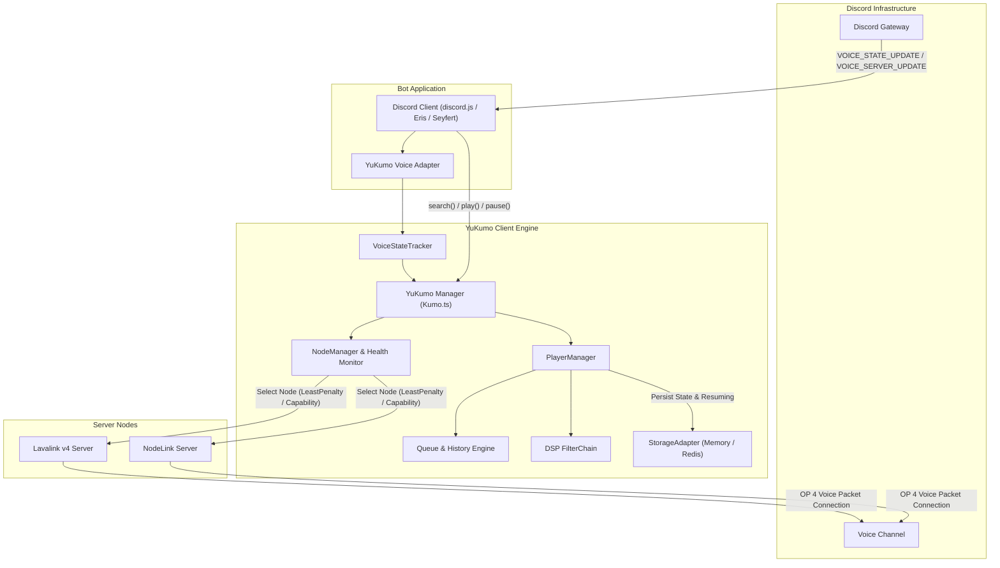

<div align="center">



<br />

[](https://github.com/Nex-Devz/YuKumo/actions/workflows/build.yml)
[](https://www.npmjs.com/package/yukumo)
[](https://nodejs.org/)
[](https://bun.sh/)
[](https://www.typescriptlang.org/)
[](https://github.com/Nex-Devz/YuKumo/stargazers)
[](https://github.com/Nex-Devz/YuKumo/network/members)
[](https://discord.gg/devz)
[](LICENSE)

</div>

<br />

YuKumo is an enterprise-grade, framework-agnostic client for Lavalink v4 and NodeLink audio clusters. Built for high-availability Discord applications, it eliminates restart-induced audio interruptions through persistent session resuming, prevents cluster failover failures with capability-aware routing across mixed node topologies, and operates with zero runtime dependencies beyond `ws`.

---

## Core Capabilities

- **Heterogeneous Cluster Pools**: Connect to Lavalink v4, NodeLink, or mixed pools under a single manager interface with automatic server family detection (`node.type`) and capability validation (`node.supports("lyrics")`).
- **Zero-Downtime Session Resuming**: Preserves session IDs and active player states across process restarts (via Memory or Redis storage) so playback continues without audio gaps.
- **Offline Track Operations**: Native byte-level track encoding and decoding (`Track.encode()`, `Track.decode()`, `Track.build()`) with zero remote server round-trips.
- **Dynamic Load Balancing**: Nine configurable node selection algorithms (`LeastPenalty`, `LeastUsed`, `CpuUsage`, `MemoryUsage`, `LowestPing`, `RegionSelector`, `RoundRobin`, `Random`, `CustomSelector`) with automatic migration on failure.
- **Full DSP Filter Chain**: Standard Lavalink filter bands (Equalizer, Timescale, Karaoke, Tremolo, Vibrato, Distortion, Rotation, LowPass, ChannelMix) plus NodeLink-native DSP filters (Echo, Reverb, Flanger, Phaser, Spatial, Compressor).
- **Framework Adapters**: First-class gateway bindings for `discord.js` v14, `Eris`, `Seyfert`, `Oceanic.js`, `Davey`, and `Discordeno`.

---

## Architecture & Data Flow



---

## Installation

```bash
# npm
npm install yukumo

# pnpm
pnpm add yukumo

# bun
bun add yukumo

# yarn
yarn add yukumo
```

### Compatibility Matrix

| Runtime / Engine | Target Version | Delivery Notes |
| :--- | :--- | :--- |
| **Node.js** | `>=18.0.0` | Dual-package export map supporting ESM and CommonJS |
| **Bun** | `>=1.0.0` | Tested natively with Bun runtime and test runner |
| **Lavalink** | `v4.x` | Complete REST and WebSocket protocol coverage |
| **NodeLink** | `v3.x` / `dev` | Auto-detected capabilities, voice receiver, and extra filters |
| **Dependencies** | `ws` (`^8.21.1`) | Minimal dependency footprint without native compilation |

---

## Quick Start

The following example initializes YuKumo with `discord.js` v14, configures least-penalty node selection with session resuming, and handles track playback:

```ts
import { Client, GatewayIntentBits } from "discord.js";
import { YuKumo, DiscordJSAdapter, LeastPenaltySelector } from "yukumo";

const client = new Client({
  intents: [
    GatewayIntentBits.Guilds,
    GatewayIntentBits.GuildVoiceStates,
    GatewayIntentBits.GuildMessages,
    GatewayIntentBits.MessageContent,
  ],
});

const yukumo = new YuKumo({
  nodes: [
    {
      name: "node-primary",
      host: "localhost",
      port: 2333,
      password: "youshallnotpass",
      secure: false,
    },
  ],
  defaultNodeSelector: new LeastPenaltySelector(),
  resuming: {
    enabled: true,
    timeout: 60,
    persistPlayers: true,
  },
});

// Bind Discord voice gateway events to YuKumo
new DiscordJSAdapter(client, yukumo);

client.once("ready", async () => {
  if (!client.user) return;
  yukumo.setUserId(client.user.id);
  await yukumo.init();
  console.log(`[Bot] Connected as ${client.user.tag}`);
});

yukumo.on("nodeReady", (nodeId) => {
  console.log(`[YuKumo] Node online: ${nodeId}`);
});

yukumo.on("trackStart", (guildId, track) => {
  console.log(`[YuKumo] Guild ${guildId} playing: ${track.info.title}`);
});

// Command execution handler
client.on("messageCreate", async (message) => {
  if (message.author.bot || !message.guild || !message.content.startsWith("!play ")) return;

  const voiceChannel = message.member?.voice.channel;
  if (!voiceChannel) {
    await message.reply("Join a voice channel before running this command.");
    return;
  }

  const query = message.content.slice(6).trim();
  const searchResult = await yukumo.search(query, { requester: message.author });

  if (searchResult.tracks.length === 0) {
    await message.reply("No tracks found matching query.");
    return;
  }

  const track = searchResult.tracks[0];
  await yukumo.createPlayer({
    guildId: message.guild.id,
    voiceChannelId: voiceChannel.id,
    textChannelId: message.channel.id,
  });

  await yukumo.play(message.guild.id, track);
  await message.reply(`Enqueued: **${track.info.title}** by **${track.info.author}**`);
});

client.login(process.env.DISCORD_TOKEN);
```

---

## Heterogeneous Cluster Support

YuKumo allows Lavalink v4 and NodeLink instances to coexist in the same node pool. Server families are detected automatically via `/v4/info` upon connection, and capabilities are validated before requests are dispatched.

```ts
import { YuKumo, createLavalinkNode, createNodeLinkNode } from "yukumo";

const yukumo = new YuKumo({
  nodes: [
    createLavalinkNode({ name: "lavalink-01", host: "ll.local", port: 2333, password: "pw" }),
    createNodeLinkNode({ name: "nodelink-01", host: "nl.local", port: 2333, password: "pw" }),
  ],
});

// Capabilities can be verified directly:
const node = yukumo.nodes.get("nodelink-01");
node.supports("lyrics");        // true on NodeLink
node.supports("voiceReceive");  // true on NodeLink
node.supportsFilter("echo");    // true on NodeLink

// Requests route automatically to capable nodes in mixed pools:
const lyrics = await yukumo.getLyrics(track.encoded);
```

### Feature Matrix

| Feature | Lavalink v4 | NodeLink |
| :--- | :---: | :---: |
| Playback, Queue, Standard Filters | Supported | Supported |
| Session Resuming & Route Planner | Supported | Supported |
| Extra DSP Filters (`echo`, `reverb`, `phaser`, `flanger`) | Unsupported | Native |
| Built-in Lyrics Resolution (`getLyrics`) | Plugin | Native |
| Chapters & Meaning Endpoints | Unsupported | Native |
| Binary Voice Receive Protocol | Unsupported | Native |
| YouTube Token Configuration (`poToken`, `OAuth`) | Plugin | Native |

---

## Configuration Reference

### `ManagerOptions`

Configuration passed to the `YuKumo` constructor:

| Key | Type | Default | Description |
| :--- | :--- | :--- | :--- |
| `nodes` | `NodeConfig[]` | *(Required)* | Array of server connection configs. |
| `userId` | `string` | `undefined` | The bot user ID. Required prior to node connection. |
| `send` | `(guildId, payload) => void` | `undefined` | Gateway dispatch handler. Automatically set by official adapters. |
| `defaultSearchSource` | `string` | `"ytsearch"` | Default search source prefix (`ytsearch`, `ytmsearch`, `scsearch`, `spsearch`). |
| `defaultNodeSelector` | `NodeSelector` | `LeastPenaltySelector` | Node load balancing strategy. |
| `resuming` | `object` | `undefined` | Session resuming options: `{ enabled, timeout, persistPlayers }`. |
| `resuming.enabled` | `boolean` | `false` | Enables Lavalink/NodeLink session recovery across restarts. |
| `resuming.timeout` | `number` | `60` | Duration in seconds the server preserves sessions after client disconnect. |
| `resuming.persistPlayers` | `boolean` | `true` | Automatically restores queues, filters, and player flags on restart. |
| `storageAdapter` | `StorageAdapter` | `MemoryStorage` | Backend storage adapter (`MemoryStorage` or `RedisStorage`). |
| `voiceConnectionTimeout`| `number` | `15000` | Milliseconds to await voice handshake before throwing. |
| `voiceConnectionRetries`| `number` | `0` | Reconnection retry count for establishing voice channel links. |
| `onDisconnect` | `object` | `{ destroyPlayer: true }` | Behavior on channel disconnect (`destroyPlayer` or `autoReconnect`). |
| `linksAllowed` | `boolean` | `true` | When false, rejects direct URL search queries. |
| `linksWhitelist` | `(RegExp \| string)[]` | `[]` | Allowed URL pattern whitelist. |
| `linksBlacklist` | `(RegExp \| string)[]` | `[]` | Explicitly blocked URL pattern blacklist. |
| `httpHeaders` | `Record<string, string>`| `undefined` | Headers attached to REST calls and WebSocket handshakes. |
| `queueOptions` | `object` | `{ persist: false, maxHistorySize: 50 }` | Queue persistence and history buffer limits. |
| `playerDefaults` | `object` | *See types* | Global player limits (`maxErrorsPerTime`, `minAutoPlayMs`). |
| `logger` | `Logger` | `NoopLogger` | Internal logging implementation (`ConsoleLogger` or custom). |
| `logLevel` | `"debug" \| "info" \| "warn" \| "error" \| "silent"` | `"warn"` | Filter threshold for logged events. |

### `NodeConfig`

Configuration passed to individual entries in the `nodes` array:

| Key | Type | Default | Description |
| :--- | :--- | :--- | :--- |
| `host` | `string` | *(Required)* | Remote host address or domain name. |
| `port` | `number` | *(Required)* | Server HTTP/WebSocket port. |
| `password` | `string` | *(Required)* | Server authorization password. |
| `name` | `string` | `"host:port"` | Unique node identifier. |
| `secure` | `boolean` | `false` | Enable TLS encryption (`wss://` and `https://`). |
| `type` | `"lavalink" \| "nodelink" \| "auto"` | `"auto"` | Server family (`"auto"` queries `/v4/info` on connect). |
| `region` | `string` | `undefined` | Voice region identifier for region-based routing. |
| `resuming` | `boolean` | `false` | Enables session resuming specifically for this node. |
| `resumeTimeout` | `number` | `60` | Server-side session retention timeout in seconds. |
| `connectTimeout` | `number` | `15000` | Handshake timeout in milliseconds. |
| `enableHeartbeat` | `boolean` | `true` | Sends active ping frames to detect dead TCP connections. |
| `heartbeatIntervalMs` | `number` | `30000` | Milliseconds between heartbeat pings. |
| `heartbeatTimeoutMs` | `number` | `10000` | Milliseconds to wait for pong before terminating socket. |
| `maxRetries` | `number` | `Infinity` | Maximum consecutive reconnection attempts. |
| `retryDelay` | `number` | `1000` | Initial exponential backoff reconnect delay in milliseconds. |
| `retryDelayMax` | `number` | `30000` | Maximum cap for exponential backoff delay. |

---

## Observability

Expose live Prometheus metrics in OpenMetrics format for Grafana dashboards:

```ts
import { PrometheusExporter } from "yukumo";

const exporter = new PrometheusExporter(yukumo);
exporter.listen(9090); // Metrics available at http://localhost:9090/metrics
```

---

## Troubleshooting

<details>
<summary><b>Error: Voice connection timeout after 15000ms</b></summary>

### Cause
The client did not receive `VOICE_STATE_UPDATE` and `VOICE_SERVER_UPDATE` from the Discord Gateway before the handshake timer expired.

### Resolution
1. Confirm that `GatewayIntentBits.GuildVoiceStates` is enabled in both your client initialization and the Discord Developer Portal:
   ```ts
   const client = new Client({
     intents: [GatewayIntentBits.Guilds, GatewayIntentBits.GuildVoiceStates],
   });
   ```
2. Verify that the adapter is instantiated and registered:
   ```ts
   new DiscordJSAdapter(client, yukumo);
   ```
3. Verify that the bot role has Connect and Speak permissions in the target channel.
</details>

<details>
<summary><b>YukumoUnsupportedFeatureError: Node does not support feature: [feature]</b></summary>

### Cause
A requested capability (e.g. lyrics, chapters, or binary voice receive) was dispatched to a node that does not implement it.

### Resolution
1. In mixed clusters, route requests using capability filters:
   ```ts
   const node = yukumo.nodes.pick(guildId, { feature: "lyrics" });
   const lyrics = await node.rest.getLyrics(track.encoded);
   ```
2. Query capabilities defensively:
   ```ts
   if (node.supports("voiceReceive")) {
     const receiver = node.createVoiceReceiver(guildId);
   }
   ```
</details>

<details>
<summary><b>YouTube HTTP 429 or Bot Detection Challenge</b></summary>

### Cause
YouTube IP rate limiting or proof-of-origin verification requirements.

### Resolution
Configure Proof of Origin (`poToken`) and visitor data or OAuth refresh tokens dynamically at runtime without restarting servers:

```ts
const node = yukumo.nodes.get("node-primary");
await node.rest.setYouTubePoToken("YOUR_PO_TOKEN", "YOUR_VISITOR_DATA");
await node.rest.setYouTubeRefreshToken("YOUR_REFRESH_TOKEN");
```
</details>

<details>
<summary><b>Audio drops during bot process restart</b></summary>

### Cause
Restart duration exceeded the resume timeout or player snapshots were not restored before reconnecting.

### Resolution
1. Extend `resuming.timeout` in your manager options:
   ```ts
   const yukumo = new YuKumo({
     resuming: { enabled: true, timeout: 120, persistPlayers: true },
   });
   ```
2. Use `RedisStorage` for distributed architectures or container restarts:
   ```ts
   import { RedisStorage } from "yukumo";
   import Redis from "ioredis";

   const yukumo = new YuKumo({
     storageAdapter: new RedisStorage(new Redis("redis://localhost:6379")),
     resuming: { enabled: true, timeout: 120 },
   });
   ```
</details>

<details>
<summary><b>Voice connection closed with code 4014</b></summary>

### Cause
Discord WebSocket close code `4014` indicates that the bot was moved to another channel, disconnected by an admin, or lost voice permissions.

### Resolution
YuKumo clears invalidated voice credentials and waits for new endpoint negotiation automatically. Enable `onDisconnect.autoReconnect` to restore playback in the previous channel:

```ts
const yukumo = new YuKumo({
  onDisconnect: {
    destroyPlayer: false,
    autoReconnect: true,
  },
});
```
</details>

---

## Reference Implementations

Complete, runnable examples are maintained in the [`examples/`](examples) directory:

| Implementation | Framework / Environment | Location |
| :--- | :--- | :--- |
| **discord.js v14** | TypeScript, Slash Commands | [`examples/discordjs`](examples/discordjs) |
| **Seyfert** | TypeScript | [`examples/seyfert`](examples/seyfert) |
| **Oceanic.js** | TypeScript | [`examples/oceanic`](examples/oceanic) |
| **Eris** | TypeScript | [`examples/eris`](examples/eris) |
| **Discordeno** | TypeScript | [`examples/discordeno`](examples/discordeno) |
| **Pure TypeScript** | Node.js | [`examples/ts/bot.ts`](examples/ts/bot.ts) |
| **CommonJS** | Node.js | [`examples/js-cjs/bot.js`](examples/js-cjs/bot.js) |
| **ESM** | Node.js / Bun | [`examples/js-esm/bot.js`](examples/js-esm/bot.js) |
| **Davey Voice** | TypeScript | [`examples/davey-voice.ts`](examples/davey-voice.ts) |

---

## Star History

<div align="center">

<a href="https://star-history.com/#Nex-Devz/YuKumo&Date">
  <picture>
    <source media="(prefers-color-scheme: dark)" srcset="https://api.star-history.com/svg?repos=Nex-Devz/YuKumo&type=Date&theme=dark" />
    <source media="(prefers-color-scheme: light)" srcset="https://api.star-history.com/svg?repos=Nex-Devz/YuKumo&type=Date" />
    
  </picture>
</a>

</div>

---

## Contributors

Contributions are welcome. Please read [CONTRIBUTING.md](CONTRIBUTING.md) before opening pull requests or reporting issues.

<div align="center">

<a href="https://github.com/Nex-Devz/YuKumo/graphs/contributors">
  
</a>

</div>

---

## License

Distributed under the [MIT License](LICENSE).
